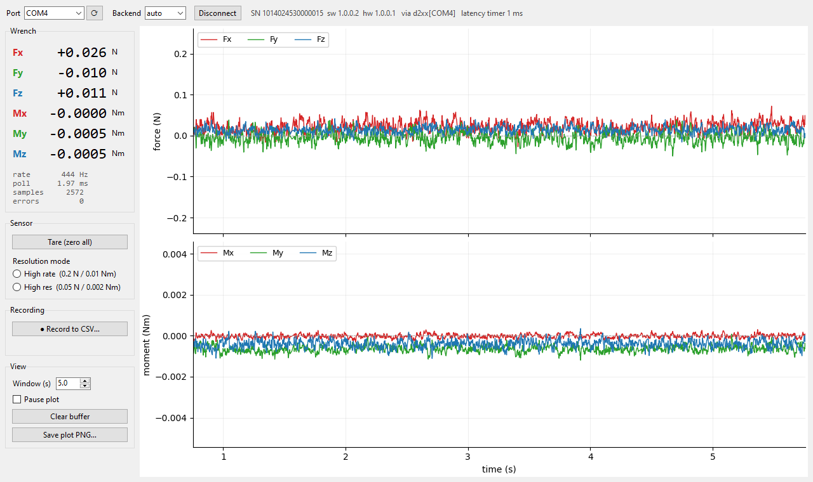

# qidian-ft

[](https://github.com/Yuxiang-Ma/qidian-ft/actions/workflows/ci.yml)
[](https://www.python.org/)
[](LICENSE)

Driver, recorder and desktop GUI for the **KEYDYN QS-Z4-4530Ti-1** six-axis
force/torque sensor over RS-485 (Modbus-RTU).

It reaches **~470 Hz** headless and **~420 Hz** with the live GUI open. A stock
USB adapter setup gets ~60 Hz. No registry edit or admin rights are needed:
on Windows the package sets the FTDI latency timer through D2XX.

Measured on SN `1014024530000015` (sw 1.0.0.2, hw 1.0.0.1), with an FTDI FT232R
USB-RS485 adapter on Windows 10.



## Install

```bash
pip install "qidian-ft[viz] @ git+https://github.com/Yuxiang-Ma/qidian-ft"
```

`[viz]` adds numpy and matplotlib, which the GUI and plots need. Without it you
get just the driver and recorder (pyserial plus the standard library).
`import qidian_ft` never loads numpy or matplotlib, and a test enforces that.

On Windows the `d2xx` backend uses `ftd2xx.dll`, which ships with FTDI's standard
driver. On Linux the `serial` backend is selected automatically.

### Ubuntu / Linux

The kernel's `ftdi_sio` driver handles the adapter, so no extra driver is
needed. Do this once:

```bash
sudo apt install python3-tk                         # only for the GUI
qidian-ft udev-rule | sudo tee /etc/udev/rules.d/70-qidian-ft.rules
sudo udevadm control --reload-rules                 # then replug the adapter
qidian-ft info                                      # port is /dev/ttyUSB0
```

The rule does three things for FTDI adapters:
- sets the latency timer to 1 ms, giving ~470 Hz instead of ~60 Hz;
- lets the logged-in desktop user open the port;
- keeps ModemManager from probing it.

The access part covers every FTDI serial adapter for whoever is logged in at
the desktop. That's fine on a lab PC, but SSH sessions don't get it and still
need the `dialout` group.

Without the rule, the driver still asks for 1 ms itself (`ASYNC_LOW_LATENCY`,
no root needed), and you can get port access with
`sudo usermod -aG dialout $USER` followed by logging out and back in.
`qidian-ft info` prints the latency timer in effect. A CH340-based adapter
that disappears right after plugging in is being claimed by `brltty`; fix it
with `sudo apt remove brltty`.

CI runs the full test suite on Ubuntu, including the GUI under a virtual
display. It also runs an end-to-end test that drives the real pyserial
backend over a pseudo-terminal with a simulated sensor. The ~470 Hz figures
above were measured on Windows; Linux hasn't been measured on hardware yet.

## Quick start

GUI:

```bash
qidian-ft-gui            # or: qidian-ft gui   /   python -m qidian_ft gui
```

Pick the port, then **Connect**. From there you can **Tare**, switch the
resolution mode, change the plot window, and **Record to CSV**. Recording can
start and stop while the live view keeps running.

CLI:

```bash
qidian-ft info                                   # identify, measure rate and noise
qidian-ft record --duration 10 --tare --csv run.csv --plot run.png
qidian-ft record --duration 0 --csv long.csv     # until Ctrl-C
qidian-ft plot run.csv
qidian-ft probe                                  # wiring / link diagnostics
```

Common flags: `--port COM4`, `--backend {auto,d2xx,serial}`, `--slave 1`,
`--latency 1`. The CSV is always complete. The end-of-run summary and `--plot`
use the in-memory buffer, which holds the most recent 600k samples (~21 min at
470 Hz).

Python:

```python
from qidian_ft import FTSensor, SensorConfig, Recorder

with FTSensor(SensorConfig(port="COM4")) as ft:
    print(ft.info.describe())           # SN 1014024530000015  sw 1.0.0.2  hw 1.0.0.1
    ft.tare()
    for s in ft.stream(duration_s=1.0):
        s.t_mid, s.force, s.torque     # seconds, (Fx,Fy,Fz) N, (Mx,My,Mz) Nm

    # Background acquisition; your loop never waits on the serial port.
    with Recorder(ft) as rec:
        ...
        latest = rec.latest()           # (t, fx, fy, fz, mx, my, mz, latency_ms)
        rec.start_csv("trial.csv"); ...; rec.stop_csv()
        trace = rec.trace()             # numpy-backed; trace["fz"], trace.summary()
```

## Measured performance

| Configuration | Rate | Limited by |
|---|---|---|
| FTDI VCP driver, default 16 ms latency timer | 61 Hz | latency timer |
| D2XX, timer 1 ms (set by this package) | 465–475 Hz | ~2 ms USB round trip |
| VCP with registry timer set to 1 ms | ~505 Hz | ~2 ms USB round trip |
| GUI open, default GIL switch interval (5 ms) | ~260 Hz | plot redraw holding the GIL |
| GUI open, switch interval 0.2 ms (what the GUI sets) | ~420 Hz | |

The sensor only answers when polled. At 460800 baud the request and the
29-byte reply take ~0.7 ms on the wire, and USB full-speed adds ~1 ms each way,
so ~500 Hz is the ceiling for this link. The vendor's 2000 Hz figure applies to
CAN streaming, which this package does not implement.

Windows occasionally stalls a poll for 20–60 ms. These show up in the
`latency_ms` column. Every sample carries host timestamps taken around its round
trip, so `t_s` stays accurate across a stall.

Rest noise after taring: about 0.013 N sd on Fx/Fy/Fz and 0.0002 Nm sd on
Mx/My/Mz. Setting the "high resolution" or "high rate" mode bit is accepted by
the sensor, but on this unit it made **no measurable difference** to rest noise.

## Hardware

| | |
|---|---|
| Supply | **DC 18–72 V**, < 1 W. USB 5 V or 12 V will not run it. |
| Cable | 1 brown CAN_L / RS485_A, 2 black CAN_H / RS485_B, 3 blue V−, 4 white V+ |
| Link | RS-485, **460800 baud 8N1**, Modbus slave 1 |
| Range | Fx, Fy, Fz 300 N; Mx, My, Mz 7 Nm |

The same two wires carry RS-485 **or** CAN, depending on a firmware mode bit.
This package never sets that bit, because once it's set the sensor stops
answering on RS-485 until it's switched back over CAN.

## Protocol

Modbus-RTU with function codes 0x03 and 0x10. All values are big-endian,
including IEEE-754 floats (high register first).

| Register | Count | Type | Content |
|---|---|---|---|
| 0x0100 | 16 | char | serial number |
| 0x0110 / 0x0112 | 2 / 2 | uint32 | software / hardware version |
| 0x0300 | 12 | float ×6 | Fx Fy Fz (N), Mx My Mz (Nm) |
| 0x0400 | 1 | uint16 (write only) | bit0 tare, bit1 → CAN, bit2 high-res |
| 0x0602 | 1 | uint16 | slave id 1–247 |

Tare is a one-shot command. Writing the control word again without bit0 does
not undo it (checked on hardware). The control word is write-only and always
carries the resolution bit, so the driver re-sends the mode it last set with
every tare. If no mode has been set yet, a tare selects high-rate mode.
`SensorConfig(resolution=...)` sets the mode at connect.

## Troubleshooting

Run `qidian-ft probe` first. It sends raw reads at several baud rates and slave
IDs and classifies whatever comes back:

| Verdict | Meaning |
|---|---|
| `ok` | Clean reply. |
| `silent` | Nothing at any setting. Check 18–72 V power, A/B, and whether the sensor was switched to CAN. |
| `garbage` | Bytes arrive that don't form a reply. Probably the wrong baud rate. |
| `corrupt` | Correct length but a bad CRC. Signal integrity: A/B, ground, termination, adapter. |
| `edge-corruption` | See below. |

**`edge-corruption`** is a failure seen on a real unit. That sensor received
commands and replied with frames of exactly the right length, but every reply
was garbled in the same deterministic way: `01 03 20 …` arrived as
`fd fb bf …`, and `00` as `ff`. Only the 1→0 transitions of its signal reached
the PC; each low level decayed back to idle. Under that model the faulty
unit's version reply reproduces byte-for-byte, CRC included, from the healthy
unit's values. So its firmware and data were fine and its RS-485 transmit path
was not. The rising edges are lost, so software can't decode it. The same cable,
adapter, ground and supply worked with another sensor. If you see this verdict,
swap in a known-good sensor before changing any settings.

Other messages:

| Message | Fix |
|---|---|
| `FT_OpenEx … DEVICE_NOT_FOUND` / `Could not open COM4` | Another program holds the port. Close the vendor SAFS_TOOL2 or any other recording. |
| `FTDI latency timer is 16 ms` | You are on the `serial` backend under Windows. Use `--backend d2xx`, or set Device Manager → COMx → Port Settings → Advanced → Latency Timer = 1. |
| Linux `Permission denied` | Install the udev rule (see [Ubuntu / Linux](#ubuntu--linux)), or `sudo usermod -aG dialout $USER` and log in again. |
| Linux `FTDI latency timer is 16 ms` | Install the udev rule and replug the adapter. |
| Linux `another program is using it` | Another `qidian-ft` (or `screen`, `minicom`) has the port open. |
| `Tkinter is missing` | `sudo apt install python3-tk` |

## Layout

| Path | Purpose |
|---|---|
| `qidian_ft/protocol.py` | Modbus framing, CRC, register map. Pure functions, no I/O. |
| `qidian_ft/backends/` | `d2xx` (Windows, sets the latency timer), `serial` (pyserial) |
| `qidian_ft/sensor.py` | `FTSensor`: connect, read, stream, tare, resolution |
| `qidian_ft/recorder.py` | Background acquisition, ring buffer, CSV that can be toggled while running |
| `qidian_ft/gui.py` | Tkinter + matplotlib GUI |
| `qidian_ft/diagnose.py` | `probe` sweep and edge-corruption detector |
| `qidian_ft/trace.py`, `plotting.py` | numpy trace, CSV round trip, PNG output |
| `qidian_ft/cli.py` | `qidian-ft` command |
| `qidian_ft/platform_help.py` | Linux udev rule, per-OS permission and latency hints |

## Development

```bash
pip install -e ".[dev]"
pytest -q          # hardware-free; a fake sensor speaks the Modbus protocol
ruff check .
```

The tests include real byte captures from both the healthy and the faulty
sensor.

## License

MIT. The vendor's protocol PDFs and the SAFS_TOOL2 tool are not redistributed
here; get them from the vendor.
